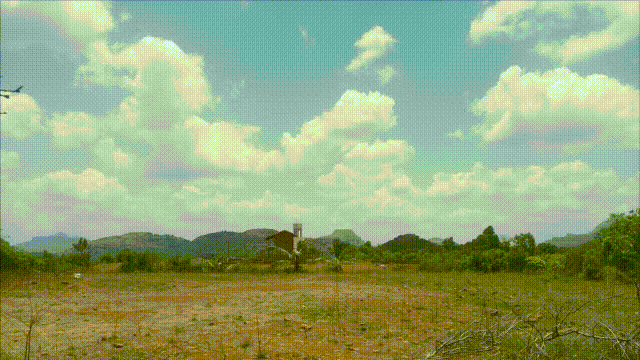

  

### Hi, I'm Devansh 👋

I'm a **control systems engineer** who likes taking a model out of the notebook and onto real hardware: small boards, tight memory budgets, real sensors and a real sky.

- 🚁 **Building:** [Project Seraphim Sky](https://github.com/devanshj27/seraphim-sky), real-time drone detection with the neural network running **on the camera sensor**
- 🔧 **Now:** hardening its on-device deployment on a Raspberry Pi 5 test bench ([rpi-imx500](https://github.com/devanshj27/rpi-imx500))
- 🔁 **How I work:** data → training → INT8 quantization → deployment → field tests, then round again
- 🌱 **Into:** robotics, embedded programming, physics simulation and Blender
- 📫 **Open to:** collaborations and roles in embedded AI, robotics and control systems

## 🚁 Featured: Project Seraphim Sky

  
   
  Outdoor field test. Every detection comes from the model running on the camera sensor.

An end-to-end drone detection system for industrial-site security. I fine-tuned **YOLO11n** on the open 83k-image Seraphim drone dataset, **INT8-quantized** it with Sony's Model Compression Toolkit and flashed it onto the **Sony IMX500 AI Camera**, so inference happens on the sensor before a frame ever reaches the **Raspberry Pi 5**.

| mAP50 | Precision | Recall | Latency | Sensor memory |
|:---:|:---:|:---:|:---:|:---:|
| **0.973** | **0.965** | **0.952** | **15–17 ms** | **7.16 / 8 MB** |

Accuracy is measured before quantization. Latency is per frame, on the sensor.

**Pipeline:** 83k images → YOLO11n fine-tune (Kaggle) → INT8 post-training quantization (Sony MCT) → IMX500 converter and packager → `network.rpk` on the sensor → Picamera2 / modlib on the Pi.

**Problems I worked through**

- **Plain-sky blind spot:** texture bias in the base dataset meant almost no detections against open sky. A fine-tune on a custom sky-background set fixed it.
- **Quantized confidence:** on-device scores snap to a few fixed levels. I traced this to INT8 quantization of the confidence head under memory-limited calibration, a platform ceiling rather than a model regression.

Python · Ultralytics · Sony MCT · IMX500 Converter · Picamera2 · modlib · OpenCV · FFmpeg · Kaggle · Colab

## 🛠️ More things I've built

| Project | What it does |
|---|---|
| 🛰️ **[RaspberryPi4-GPS-NEO6M](https://github.com/devanshj27/RaspberryPi4-GPS-NEO6M)** | Reads a u-blox GPS module over UART on a Pi 4B. It finds the right serial port, parses NMEA, reverse-geocodes the fix to an address and beeps a buzzer once it has a lock. Python · pyserial · pynmea2 · geopy · RPi.GPIO |
| 🌡️ **[RPi-health-checkup](https://github.com/devanshj27/RPi-health-checkup)** | One-shot Raspberry Pi health report: temperature, voltages, clocks, throttling flags, CPU governor and memory split. Bash · vcgencmd |
| 📡 **[IP-Activity-Scanner](https://github.com/devanshj27/IP-Activity-Scanner)** | Auto-detects your subnet, ping-sweeps its DHCP range and names live devices by hostname (mDNS/NetBIOS), MAC address and vendor. Bash · PowerShell · nmap |
| 🎧 **[AUDIOBOOK-GENERATOR](https://github.com/devanshj27/AUDIOBOOK-GENERATOR)** | Turns EPUB, PDF and TXT files into speech or MP3, offline with pyttsx3 or with more natural voices via gTTS. Built to help people with reading difficulties, or anyone who'd rather listen. Python · pyttsx3 · gTTS |
| 🧮 **[Desktop Calculator](https://github.com/devanshj27/basicprojects/tree/main/project/end_project_calculator)** | A Tkinter calculator with `Decimal`-precision math, memory keys, keyboard and clipboard support, and unit tests. Python · Tkinter · unittest |

**Open source and learning**

- 📐 Patched series expansion of `hyper()` in **SymPy** ([fix branch for issue #26250](https://github.com/devanshj27/sympy/tree/fix_26250))
- ⚛️ Explored quantum computing through the **Qiskit Global Summer School** labs (2023, 2024)

## 🧰 Toolbox

<table>
  <tr>
    <td><b>Languages</b></td>
    <td>
      
      
      
    </td>
  </tr>
  <tr>
    <td><b>AI and vision</b></td>
    <td>
      
      
      
      
      
    </td>
  </tr>
  <tr>
    <td><b>Hardware</b></td>
    <td>
      
      
      
    </td>
  </tr>
  <tr>
    <td><b>Workflow</b></td>
    <td>
      
      
      
      
    </td>
  </tr>
  <tr>
    <td><b>Also into</b></td>
    <td>
      
      physics simulation · robotics
    </td>
  </tr>
</table>

## 📡 On my radar

Counter-UAS sensing beyond cameras (Remote ID, ADS-B), ROS 2 drone autonomy with PX4 and ArduPilot, low-cost LiDAR, RF-DETR for small aerial targets, and stereo depth on edge accelerators like the Hailo-8.

---

Building things that see, sense and steer.

